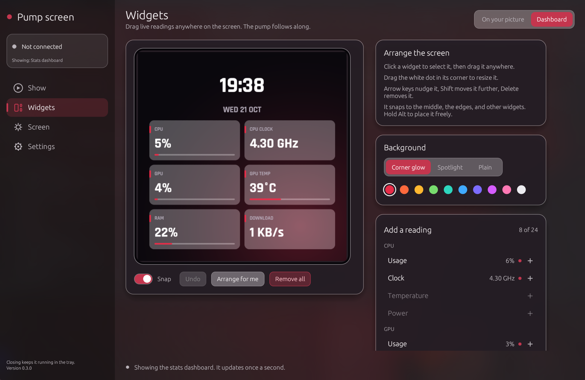

# strix-lc-screen

A small app that drives the pump screen on a ROG Strix LC IV / SLC IV cooler. It replaces the official **ROG STRIX LC & SLC IV Series** program, which stays heavy while it is open.

The panel is a 720×720 screen on USB device `0B05:1DE7`. This app talks to that device directly. On Windows, quit the ASUS app first. Both programs want the same USB connection, and the official one wins if it is running.



## What you can do

- Set brightness, rotation (0°, 90°, 180°, 270°), and wake or sleep the screen.
- Show a photo, a GIF, or a video of up to a minute, with a crop box and a zoom slider.
- Change playback speed from 0.25× to 2× while the clip is running. 1× matches the length of the video.
- Close the window and leave the clip running. A tray icon stays behind.
- Start the app when you sign in, hidden in the tray if you want, and send the last file again on its own.
- Place live readings anywhere on the screen, over your photo or video or on a stats dashboard. Drag them on a preview of the pump, resize them from the corner, and pick a style for each one: text, tile, gauge, or bar, in one of ten colors. Readings: the time and date, CPU usage and clock, GPU usage, clock, temperature, power, fan, and memory (NVIDIA cards), RAM, disk space and speed, and network speed. The app redraws them once a second, so they stop updating when the app quits.
- Give the dashboard a corner glow, a spotlight, or a plain background, and show temperatures in °C or °F.
- Go back to the pump's own animation. It is stored in the pump, so it keeps playing after this app quits.
- Turn the screen on or off, and choose whether it plays the standby clip while the computer sleeps. These are the same switches the ASUS app has, and the pump remembers them.
- Put the pump screen to sleep while the computer is locked.
- Update the pump's firmware with a package from ASUS, such as `FW_ROG_Strix_LC_IV_360_ARGB_LCD_V1.0.6.zip`. The app checks that the package is for this model, is not damaged, and is not older than the pump's firmware, then sends it the same way the ASUS app does. The pump restarts on its own afterwards.

### CPU temperature, pump, and fan speeds

Windows does not let programs read these without a driver. If [HWiNFO](https://www.hwinfo.com/) is running with **Shared Memory Support** turned on in its settings, the stats panel also offers CPU temperature and power, pump speed, coolant temperature, and fan speed. On Linux, CPU temperature comes from the kernel.

The pump and fans are not controlled by this USB device. They run from the motherboard headers, so set their curves in the BIOS or a fan control program.

Click the tray icon to open the window. Right-click it to stop the video or quit. **Stop video** leaves the last frame on the pump. **Quit** exits the program.

## The pump does not keep the clip

Custom pictures are sent as JPEG frames from this computer. The cooler does not store them. About a second after frames stop, the pump goes back to its built-in clip. This app keeps sending the current picture while it is running, including when the window is hidden in the tray. After you quit, the built-in clip comes back.

Video is limited to 60 seconds, sampled at up to 24 frames per second.

## Downloads

Builds are on the [releases page](https://github.com/xnixy/strix-lc-screen/releases). Each download includes ffmpeg.

- `strix-lc-screen-windows-x86_64.zip`. Unzip it and run `strix-lc-screen.exe`. Keep `ffmpeg.exe` in that folder.
- `strix-lc-screen-linux-x86_64.tar.gz`. The program, ffmpeg, and a udev rule.
- `strix-lc-screen_<version>_amd64.deb` for Debian and Ubuntu.

The package installs the program and the USB permission. After it is installed, unplug the cooler and plug it back in, then run `strix-lc-screen`.

If you use the tarball, copy the rule yourself:

```bash
sudo cp 60-strix-lc-screen.rules /etc/udev/rules.d/
sudo udevadm control --reload-rules && sudo udevadm trigger
```

Unplug and plug the cooler back in, then run `./strix-lc-screen` from that folder.

The tray icon works on KDE, Sway, and Ubuntu. Other GNOME desktops need the AppIndicator extension. **Choose file** opens the system file picker. On Linux that needs `xdg-desktop-portal`.

## Build it yourself

Install [Rust](https://rustup.rs/).

```powershell
cargo build --release
.\target\release\strix-lc-screen.exe
```

On Debian or Ubuntu:

```bash
sudo apt install build-essential pkg-config libudev-dev libxkbcommon-dev \
  libwayland-dev libx11-dev libxcb1-dev libxcursor-dev libxi-dev libxrandr-dev \
  libgl1-mesa-dev
cargo build --release
./target/release/strix-lc-screen
```

A source build does not include ffmpeg. Install it, or put the `ffmpeg` binary in the same folder as the program. To put ffmpeg inside the `.deb`, run `./packaging/fetch-ffmpeg.sh`, then `cargo install cargo-deb` and `cargo deb`. The package is in `target/debian/`.

With no arguments, the program opens the window. Sign-in startup uses `--tray`, which opens straight into the tray.

```powershell
.\target\release\strix-lc-screen.exe status
.\target\release\strix-lc-screen.exe brightness 80
.\target\release\strix-lc-screen.exe rotate 180
.\target\release\strix-lc-screen.exe power resume
.\target\release\strix-lc-screen.exe power suspend
.\target\release\strix-lc-screen.exe show "C:\Pictures\photo.png"
.\target\release\strix-lc-screen.exe screen off
.\target\release\strix-lc-screen.exe standby on
.\target\release\strix-lc-screen.exe clip 2
```

The same commands work on Linux. `power resume` wakes the screen. `power suspend` puts it to sleep. `screen off` keeps it dark, even after a wake, until `screen on`. Rotation is 0, 90, 180, or 270. Brightness is 0 through 100. `clip` plays built-in clip 1 or 2. If this app is running and sending a picture, use its window instead, or the picture covers the clip again.

Settings are saved in `%APPDATA%\strix-lc-screen\settings.json` on Windows, and in `~/.config/strix-lc-screen/settings.json` on Linux.

## License

MIT. See [LICENSE](LICENSE). ffmpeg in the downloads is a separate program, under the LGPLv2.1. `FFMPEG.txt` in the download has the build it came from. The stats panel uses the Rajdhani font by the Indian Type Foundry, under the SIL Open Font License. See [assets/fonts/OFL.txt](assets/fonts/OFL.txt).
